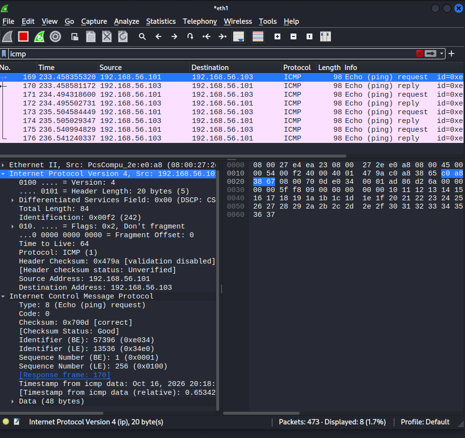
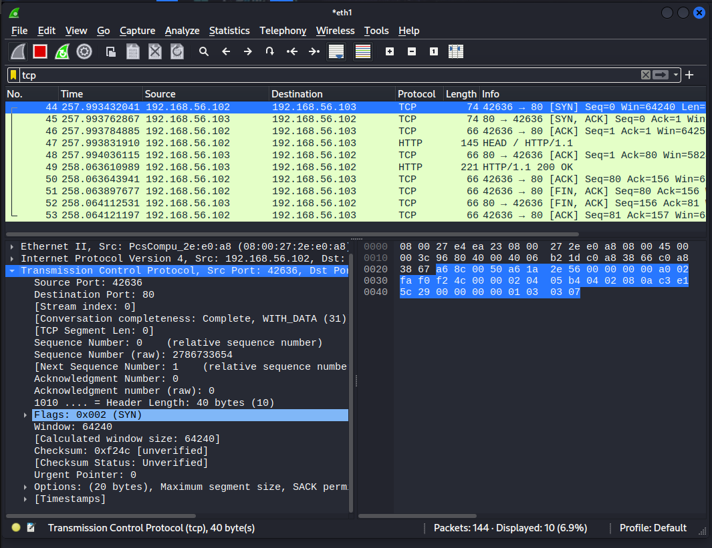
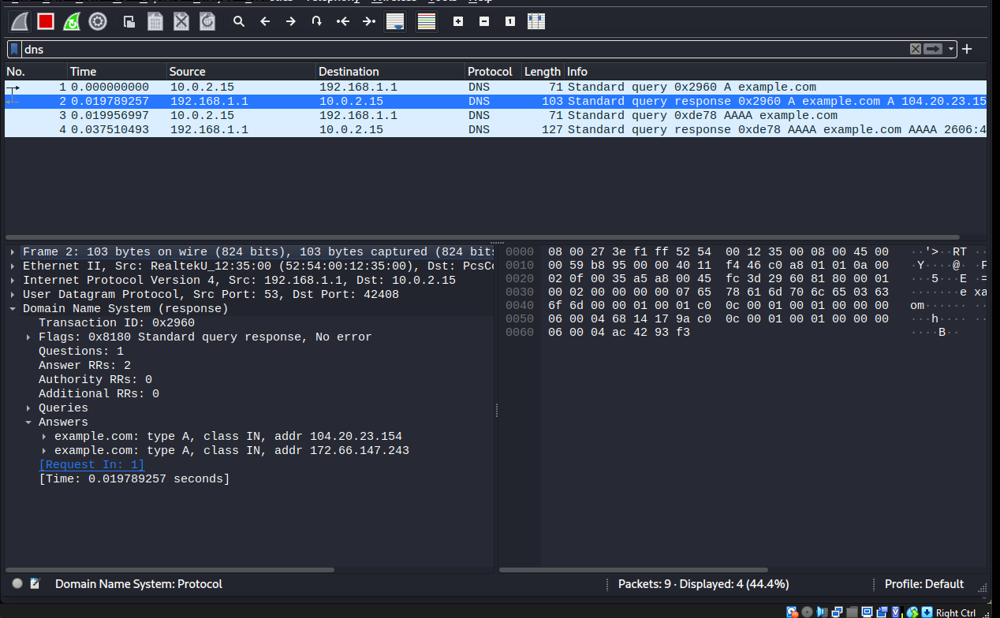

# Network Traffic Analysis with Wireshark

**Hands-On Networking & Cybersecurity Portfolio Project**

## Project Overview

This project demonstrates hands-on network traffic analysis using Wireshark in a controlled VirtualBox laboratory.

I captured and analyzed ICMP, TCP, HTTP, and DNS traffic to understand network communication, identify protocol behavior, and troubleshoot connectivity issues.

The project includes three practical investigations, packet capture evidence, and a technical analysis report.

## Lab Environment

| Component | Technology |
|---|---|
| Virtualization | Oracle VirtualBox |
| Analysis workstation | Kali Linux |
| Target system | Metasploitable 2 |
| Packet analyzer | Wireshark 4.0.7 |
| Network interfaces | NAT and Host-Only |
| Protocols analyzed | ICMP, TCP, HTTP, DNS |

## Investigation 1 — ICMP Traffic Analysis

**Objective:** Verify network connectivity and examine ICMP echo requests and replies.

**Activities performed:**

- Generated ICMP traffic between Kali Linux and Metasploitable.

- Captured packets using Wireshark.

- Applied the `icmp` display filter.

- Identified four echo requests and four corresponding replies.

- Examined ICMP Type 8 and Code 0.

**Evidence:**

[View ICMP Filtered Capture](captures/01-icmp-filtered-capture.pcapng)

## Investigation 2 — TCP Three-Way Handshake

**Objective:** Examine TCP connection establishment and HTTP communication.

**Activities performed:**

- Initiated an HTTP HEAD request from Kali to Metasploitable.

- Captured the SYN, SYN-ACK, and ACK handshake.

- Identified TCP destination port 80.

- Examined the HTTP HEAD request and `HTTP/1.1 200 OK` response.

- Observed TCP connection termination.

**Evidence:**

[View TCP Packet Capture](captures/02-tcp-handshake-analysis.pcapng)

## Investigation 3 — DNS Traffic Analysis

**Objective:** Analyze DNS queries and responses for domain name resolution.

**Activities performed:**

- Captured DNS traffic on Kali's NAT interface.

- Generated DNS queries for `example.com`.

- Identified A and AAAA record queries.

- Examined returned IPv4 addresses.

- Analyzed the DNS response status and response time.

**Evidence:**

[View DNS Packet Capture](captures/03-dns-traffic-analysis.pcapng)

## Network Troubleshooting

During the laboratory, I encountered and resolved network connectivity problems involving VirtualBox and Linux NetworkManager.

**Issues identified:**

- Disconnected NAT interface (`eth0`).

- Missing default route.

- Failed DNS resolution.

- Host-only interface (`eth1`) without an IPv4 address.

- NetworkManager profile associated with the wrong interface.

**Resolution:**

- Restored NAT connectivity and the default gateway.

- Verified DNS resolution using `nslookup`.

- Created a dedicated host-only connection profile.

- Assigned a static IP address to `eth1`.

- Verified Kali-to-Metasploitable communication with zero packet loss.

## Technical Skills Demonstrated

- Network packet capture and analysis

- Wireshark display filters

- TCP/IP networking fundamentals

- ICMP connectivity analysis

- TCP three-way handshake interpretation

- HTTP request and response analysis

- DNS A and AAAA record analysis

- Linux networking and troubleshooting

- VirtualBox network configuration

- Technical reporting and evidence documentation

## Project Files

- [Technical Investigation Report](reports/network-traffic-analysis-report.md)

- [ICMP Full Capture](captures/01-icmp-connectivity-analysis.pcapng)

- [ICMP Filtered Capture](captures/01-icmp-filtered-capture.pcapng)

- [TCP Capture](captures/02-tcp-handshake-analysis.pcapng)

- [DNS Capture](captures/03-dns-traffic-analysis.pcapng)

## Conclusion

This project strengthened my practical understanding of network communication, protocol analysis, and troubleshooting.

The investigations demonstrate skills applicable to IT Support, Network Support, Security Operations Center (SOC), and entry-level Cybersecurity Analyst positions.

**Environment:** All testing was performed in an authorized virtual laboratory for educational and professional development purposes.

